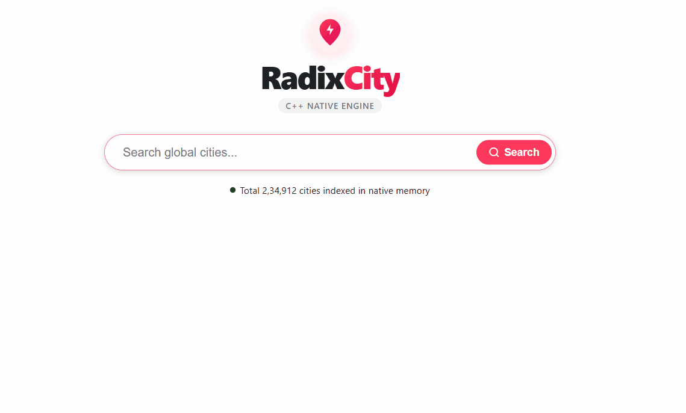
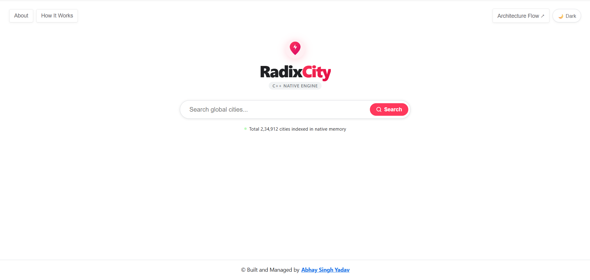

# ⚡ RadixCity: High-Performance Global Cities Autocomplete Engine

[](https://nodejs.org)
[](https://isocpp.org)
[](https://nodejs.org/api/n-api.html)
[](https://react.dev)
[](https://www.mongodb.com)

> A low-latency hybrid search engine indexing **234,912+ global cities** in native C++ heap memory. Delivers microsecond-level prefix searches and Levenshtein typo corrections through a zero-overhead Node-API (N-API) memory bridge.



## 📸 Application Preview

### 🔍 Interactive Autocomplete Interface


### ⚡ Latency Comparison: Before vs. After C++ Native Engine

| 🐢 Before C++ Engine (MongoDB Scan) | 🚀 After Native C++ Engine (Radix + BK-Tree) |
| :---: | :---: |
|  |  |
| *Database query & network round-trip latency* | *Sub-millisecond native C++ memory retrieval* |

---

## 🎯 Why This Architecture? (Problem vs. Solution)

Traditional web autocomplete implementations suffer from three major bottlenecks at scale:
1. **Database Network & Index Contention:** Firing `SELECT ... LIKE 'tok%'` or MongoDB `$regex` queries on every keystroke triggers expensive B-Tree index scans and network round-trips (~250–300ms per keystroke).
2. **V8 Heap Bloat & GC Pauses:** Storing 250,000+ deeply nested Trie nodes as JavaScript objects inside Node.js exhausts the V8 heap limit and causes frequent Stop-The-World Garbage Collection stalls.
3. **Expensive Typo Tolerance:** Running linear Levenshtein distance checks across 250k strings takes $O(N \cdot M \cdot K)$ per query, making real-time fuzzy search unviable in pure JS.

**RadixCity solves this by moving the indexing and search algorithms into a compiled C++ native addon (`.node`) while keeping Node.js strictly as an asynchronous HTTP orchestration layer.**

---

## 🏛️ System Architecture & Execution Flow

```text
[ USER KEYSTROKE ] ('tok')
        │
        ▼
┌────────────────────────────────────────────────────────┐
│                   FRONTEND (React)                     │
│  [ LRU Cache (Map) ] ──► Hit? ──► Instant 0ms render   │
│         │ Miss                                         │
│         ▼                                              │
│  [ Debouncer (200ms) ] ──► Prevents network spam       │
└───────────────────────┬────────────────────────────────┘
                        │ HTTP GET /api/search?q=tok
                        ▼
┌────────────────────────────────────────────────────────┐
│              BACKEND (Node.js + Express)               │
│  Stateless orchestration & nanosecond latency timer    │
└───────────────────────┬────────────────────────────────┘
                        │ Node-API (N-API) Bridge
                        ▼
┌────────────────────────────────────────────────────────┐
│            CORE ENGINE (Native C++ Binary)             │
│                                                        │
│  ┌──────────────────────────────────────────────────┐  │
│  │  Compressed Radix Tree                           │  │
│  │  • O(L) Edge Traversal                           │  │
│  │  • Precomputed Top-5 Min-Heaps by Population     │  │
│  └──────────────────────────────────────────────────┘  │
│                           │ Zero Matches (Typo)        │
│                           ▼                            │
│  ┌──────────────────────────────────────────────────┐  │
│  │  BK-Tree (Burkhard-Keller)                       │  │
│  │  • Fuzzy Fallback (Edit Distance ≤ 2)            │  │
│  │  • Triangle Inequality Metric Pruning            │  │
│  └──────────────────────────────────────────────────┘  │
└───────────────────────▲────────────────────────────────┘
                        │ Boot-time Hydration (One-Time)
┌───────────────────────┴────────────────────────────────┐
│               PERSISTENCE (MongoDB)                    │
│  Hydrates 234,912 records into native RAM at startup   │
│  Serves on-demand GeoJSON & metadata on city selection │
└────────────────────────────────────────────────────────┘
```

---

## 🧠 Algorithmic & Data Structure Deep-Dive

### 1. Compressed Radix Tree (Patricia Trie) with Precomputed Top-$K$
Instead of a standard Trie where every single character allocates a new node with 26+ nullable pointers, RadixCity uses an **edge-compressed Radix Tree**:
- **Path Compression:** Chains of single-child nodes are merged into single string edges (e.g., `"francisco"`), dramatically reducing pointer overhead and improving CPU cache locality.
- **$O(1)$ Result Extraction via Bounded Top-$K$:** A naive Trie must traverse the entire subtree beneath a prefix node and sort thousands of matching cities on every query. In RadixCity, each `RadixTreeNode` maintains a bounded **Top-5 vector sorted by population** during insertion. Once traversal reaches the target prefix node in $O(L)$ time, returning the top 5 most populated cities is an instant **$O(1)$ read**.

### 2. Burkhard-Keller Tree (BK-Tree) for Typo Tolerance
When a user makes a spelling mistake (e.g., `"londn"` or `"pariss"`) and the Radix Tree returns 0 exact prefix matches, the engine automatically falls back to a **BK-Tree** built over cities with population $\ge 10,000$:
- **Metric Space Pruning:** Levenshtein edit distance forms a valid metric space satisfying the triangle inequality:
  $$|d(q, u) - d(u, v)| \le d(q, v)$$
- During recursive search with maximum edit distance $k = 2$, if the distance between the query $q$ and current node $u$ is $d(q, u)$, the engine **only** inspects child branches whose edge weight falls within:
  $$[d(q, u) - 2, \; d(q, u) + 2]$$
- This prunes 90%+ of the search space compared to a brute-force edit-distance scan.

### 3. Client-Side $O(1)$ LRU Cache & DevTools Hook
- Built a custom React hook (`useLRUCache`) backed by JavaScript's `Map` insertion-order guarantees.
- Repeated prefixes and `Backspace` keystrokes resolve in **0ms** directly from browser memory without firing network requests.
- Exposed via `window.__LRU_CACHE__.dump()` so developers can inspect live cache hits and eviction states directly in Chrome DevTools.

---

## 📊 Performance Benchmark Report

* **Dataset:** 235,914 city records (GeoNames `cities500`)
* **Workload:** 1,000 randomized queries (exact prefixes + fuzzy typo fallbacks)
* **Comparison:** MongoDB `$regex` (indexed with population sort) vs. Native C++ Engine (Compressed Radix + BK-Tree via Node-API)

### 📈 Visual Latency Profile (Lower is Better)

```text
-----------------------------------------------------------------------------------------
Metric       MongoDB Regex                      Native C++ Engine
-----------------------------------------------------------------------------------------
Median (p50) [████████████████████] 284.33 ms   [▏                  ] 0.011 ms (~25,800x)
Average      [████████████████████] 285.16 ms   [▎                  ] 2.75 ms  (~104x)
p95          [████████████████████] 295.88 ms   [█                  ] 13.87 ms (~21x)
p99          [████████████████████] 303.63 ms   [█▏                 ] 17.91 ms (~17x)
-----------------------------------------------------------------------------------------

Throughput Comparison (Higher is better)
-----------------------------------------------------------------------------------------
MongoDB Regex     [▏                  ]   4 req/s
Native C++ Engine [████████████████████] 364 req/s (~91x)
-----------------------------------------------------------------------------------------
```

### 🔍 Core Observations
- **Microsecond Median Latency:** Lookups hitting the Compressed Radix Tree resolve in **11 µs (`0.011 ms`)**, completely eliminating database network round-trips and B-Tree index scan overhead.
- **Bounded Fuzzy Tail Latency:** The worst-case tail latencies ($p95$ at `13.87 ms` and $p99$ at `17.91 ms`) represent BK-Tree Levenshtein metric traversals on misspelled queries—still **17x faster** than MongoDB's baseline prefix query.
- **V8 Garbage Collection Stability:** Storing the index in the native C++ process heap (`std::unique_ptr`) isolates the Node.js V8 runtime from memory pressure and GC pauses under sustained load.

---

## 📂 Monorepo Structure

Managed with **npm Workspaces** for clean separation between the UI, HTTP layer, database models, and C++ native addon:

```text
autocomplete-monorepo/
├── apps/
│   ├── client/                   # React + Vite frontend
│   │   └── src/
│   │       ├── components/       # SearchBar, Dropdown, CityDetailModal, FlowchartModal
│   │       └── hooks/            # useLRUCache, useDebounce, useTheme
│   └── server/                   # Express.js API orchestration server
│       └── src/
│           ├── index.js          # MongoDB boot hydration -> C++ initEngine()
│           └── app.js            # REST routes & hrtime.bigint() latency headers
├── packages/
│   ├── database/                 # Mongoose schemas & GeoNames batch seeder
│   │   ├── raw-data/             # GeoNames cities500.txt (234k+ records)
│   │   └── src/
│   │       ├── models/City.js    # GeoJSON Point coordinates & compound indexes
│   │       └── seed.js           # Stream-based chunked uploader (1,000/batch)
│   └── native-engine/            # Node-API C++17 Native Addon
│       ├── binding.gyp           # node-gyp build configuration
│       └── src/
│           ├── addon.cpp         # N-API JS <-> C++ memory bridge
│           ├── RadixTree.cpp/.h  # Compressed Radix Tree + Top-K Min-Heap
│           ├── BKTree.cpp/.h     # Burkhard-Keller Levenshtein metric tree
│           └── Types.h           # CityRecord & population comparators
└── package.json                  # Workspace root scripts
```

---

## 🔌 REST API Reference

### 1. Prefix & Fuzzy Autocomplete Search
```http
GET /api/search?q=<query>&limit=<number>
```

| Parameter | Type | Default | Description |
| :--- | :--- | :--- | :--- |
| `q` | `string` | *Required* | Search prefix or misspelled city query |
| `limit` | `number` | `5` | Maximum number of top-ranked cities to return |

**Response Headers:**
- `X-Server-Latency-Ms`: Exact C++ execution time measured via `process.hrtime.bigint()` (e.g., `0.014`).

**Example Response (`200 OK`):**
```json
[
  {
    "geonameid": 1850147,
    "name": "Tokyo",
    "countryCode": "JP",
    "population": 8336599
  }
]
```

### 2. Hydrate Full City Metadata & Increment Popularity
```http
GET /api/city/:geonameid
```
Fetches full GeoJSON coordinates from MongoDB and atomically increments the city's `searchFrequency` counter (`$inc`).

**Example Response (`200 OK`):**
```json
{
  "_id": "660c1f...",
  "geonameid": 1850147,
  "name": "Tokyo",
  "countryCode": "JP",
  "population": 8336599,
  "location": {
    "type": "Point",
    "coordinates": [139.69171, 35.6895]
  },
  "searchFrequency": 12
}
```

---

## 🚀 Getting Started (Local Development)

### Prerequisites
- **Node.js** `v20+`
- **Python** `v3.10+` (required by `node-gyp`)
- **C++ Compiler Toolchain:**
  - **Windows:** Visual Studio 2022 Build Tools with *"Desktop development with C++"* workload (`MSVC` + Windows SDK)
  - **macOS:** `xcode-select --install`
  - **Linux:** `sudo apt-get install build-essential`
- **MongoDB** (Atlas URI or local instance)

### 1. Clone & Install Dependencies
```bash
git clone <your-repo-url>
cd "Autocomplete Cities"
npm install
```

### 2. Configure Environment Variables
Create a `.env` file in the root of the monorepo:
```env
PORT=8000
NODE_ENV=development
CORS_ORIGIN=*

MONGO_URI=mongodb+srv://<username>:<password>@<cluster>.mongodb.net/
DB_NAME=Cities
```

### 3. Compile the C++ Native Engine
```bash
cd packages/native-engine
npm run build
cd ../..
```
*(This compiles `addon.cpp`, `RadixTree.cpp`, and `BKTree.cpp` into `packages/native-engine/build/Release/native_engine.node`)*

### 4. Seed the Database (First Time Only)
Streams `packages/database/raw-data/cities500.txt` and uploads in batches of 1,000 records:
```bash
npm run seed
```

### 5. Run Backend & Frontend
```bash
# Terminal 1: Start Express + C++ Engine Server (Port 8000)
npm run dev:server

# Terminal 2: Start React + Vite Client (Port 5173)
cd apps/client
npm run dev
```

---

## 🛠️ Debugging the Client LRU Cache in Browser DevTools

Open the browser console (`F12`) while typing in the search bar and run:
```javascript
window.__LRU_CACHE__.dump()
```
This outputs a live table of cached prefixes, result counts, and top-ranked cities stored in the client-side LRU cache.

---